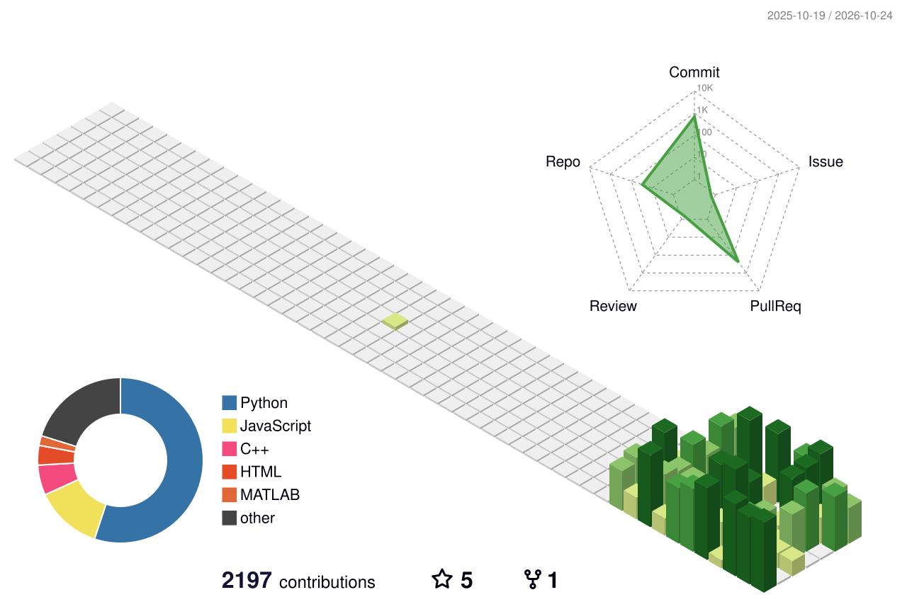
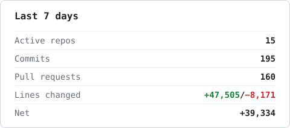

# Hi, I'm Shuoxun Wen 👋

**English** · [中文](https://github.com/Waldo0926/Waldo0926/blob/main/README.zh-CN.md)

  

  
  
   
  
  

Computer Science student at **Monash University** (Algorithms & Software major). Most of my work is **AI applications and Python backends**: MCP tools that let Claude work with real student data, API services in FastAPI and aiohttp, and the testing and deployment around them. I also build full-stack products and infrastructure automation, and I enjoy turning applied algorithms into working software.

Based in **Malaysia / China** · open to **AI application and backend internships**, available in Malaysia from **26 October 2026** and in China from **9 November 2026**, through to **February 2027**.

### Project Landscape

  

📫 **Get in touch**

  
  
  
  
   
  
  

<strong>📱 Scan to connect</strong>

 

  

---

## Selected Projects

  
  
    
  
  
    
  
  

| Project | Live | Notes |
| :---: | :---: | --- |
| **Monash Hub** | [monashhub.secureview.tech](https://monashhub.secureview.tech)  | Solo-built and in production: unit, degree and official-policy search (PostgreSQL full-text + fuzzy), course maps with prerequisite checks, WAM/GPA tools, a student community, and a UI in English, Chinese, Japanese and Korean. |
| **SecureView** | [secureview.tech](https://secureview.tech)  | Four-person Final Year Project: browser-side encryption with six AEAD suites, key-wrapped sharing, integrity verification and a hash-chained audit log. I authored 182 of the team's 203 merged PRs, spanning the security agent, integrity sweep, CI/release gates, a 22,264-operation capacity study, tamper testing, and guarded deployment. Source, tests and docs are published in the repo, view only. |
| **Monash Study Kit** | [Latest release](https://github.com/Waldo0926/monash-study-kit/releases/latest) | Local-first MCP server (27 tools) + CLI that connects Moodle and Ed to Claude behind Okta/MFA: deadlines, announcements, grades, full-text search over course materials, notes sites and lecture transcripts. Read-only by design; listed on Glama. |
| **Edge Fleet Ops Automation** | Code only | Sanitized reconstruction of automation for a real Linux edge-node fleet: node discovery, disk-health audits, Docker workload checks and stateful alerts. |
| **MUMGuide WeChat Bot** | 马莫百科 on WeChat  | Chinese Q&A bot for a student WeChat account. It answers from Q&A the owner taught it, the Monash Hub API and the account's articles, and every answer links its source. When those can't answer, a free language model may only quote sentences from the sources, and code checks each quote word for word before it is sent (published as [quotegate](https://github.com/Waldo0926/quotegate)). Built on aiohttp behind Nginx with SQLite, it fits WeChat's 5-second, 2048-byte passive reply limit. Questions it can't answer go to the owner, and the reply is remembered. Tested offline with pytest against a fake Hub. |
| **Monash Exchange Tracker (demo)** | [live demo](https://waldo0926.github.io/monash-abroad-tracker-demo/) | The private production system has crawled ~164 programs daily since August 2026, honouring `robots.txt`, with field-level change detection, a frozen previous-round comparison, hand-verified QS rankings and an access-controlled viewer. The public demo runs on synthetic data. |

The live sites above are checked every 5 minutes from GitHub Actions, and each outage opens an issue: [status page](https://waldo0926.github.io/uptime/).

## More Projects

<strong>20 more coursework-derived and independent projects, grouped by area</strong>

 

#### Student Tools & Web Utilities

| Project | What it does |
| --- | --- |
| [ed-web](https://github.com/Waldo0926/ed-web) | A privacy-first, client-side web app for fetching, organising, searching, and summarising Ed Discussion course forums. |
| [monash-attendance-reminder](https://github.com/Waldo0926/monash-attendance-reminder) | A cross-platform Chrome extension that discovers recent Monash Attendance activities, finds codes from Gmail, Moodle, and Ed with local OCR, sends reminders, and submits only after explicit confirmation. |

#### Software Systems, Networking & Infrastructure

| Project | What it does |
| --- | --- |
| [enterprise-network-security-architecture](https://github.com/Waldo0926/enterprise-network-security-architecture) | Fictional enterprise network design written as architecture-as-code and checked by an automated validator in CI. |
| [streamswitch](https://github.com/Waldo0926/streamswitch) | An RxJS packet-routing game demonstrating immutable state, typed event streams, deterministic simulation, and testable functional-reactive architecture. |
| [homelab-network-automation](https://github.com/Waldo0926/homelab-network-automation) | A sanitized reconstruction of iKuai homelab automation with router API integration, guarded connection cleanup, WAN/PPPoE/LAN monitoring, and stateful alert/recovery tracking. |
| [wifi-site-survey-analysis](https://github.com/Waldo0926/wifi-site-survey-analysis) | Privacy-safe Wi-Fi site survey analysis with RSSI, channel usage, and physical-AP-aware roaming overlap. |
| [bike-share-visualizer-cpp](https://github.com/Waldo0926/bike-share-visualizer-cpp) | A modernised C++17 reimplementation of an MFC bike-share station visualiser, with real-data tests and cross-platform CI. |

#### Algorithms, Data Structures & Low-Level Programming

| Project | What it does |
| --- | --- |
| [advanced-string-algorithms](https://github.com/Waldo0926/advanced-string-algorithms) | Pure-Python Ukkonen suffix trees, BWT approximate matching, Z-based exact matching, Rabin-Karp rolling hashes and Miller-Rabin primality testing, with pytest. |
| [classical-algorithms-cpp](https://github.com/Waldo0926/classical-algorithms-cpp) | Classic algorithms in C++: dynamic programming, backtracking, branch and bound, divide and conquer, and genetic algorithms. |
| [data-structures-labs-cpp](https://github.com/Waldo0926/data-structures-labs-cpp) | Modernised C++17 implementations covering stacks, queues, trees, Huffman coding, graphs and sorting. |
| [bst-record-management-cpp](https://github.com/Waldo0926/bst-record-management-cpp) | Modernised C++17 BST record management system with CRUD, persistence, RAII, tests and CI. |
| [n-queens-algorithm-visualizer](https://github.com/Waldo0926/n-queens-algorithm-visualizer) | N-Queens algorithm visualizer with backtracking, state-space pruning, and hill climbing. |
| [MARIE-Bitmap-Text-Renderer](https://github.com/Waldo0926/MARIE-Bitmap-Text-Renderer) | MARIE assembly bitmap renderer with indirect addressing, pointer arithmetic, a 4×8 font, and a memory-mapped framebuffer. |

#### Data, ML & Analytics

| Project | What it does |
| --- | --- |
| [tensorflow-cnn-image-classification](https://github.com/Waldo0926/tensorflow-cnn-image-classification) | Reproducible TensorFlow/Keras CNN experiments on CIFAR-10 and MNIST with automated evaluation. |
| [student-performance-ml-pipeline](https://github.com/Waldo0926/student-performance-ml-pipeline) | Leakage-safe student grade classification with scikit-learn pipelines, SVM, Random Forest, and imbalance-aware evaluation. |
| [pattern-recognition-from-scratch](https://github.com/Waldo0926/pattern-recognition-from-scratch) | Classical pattern-recognition algorithms implemented from scratch with NumPy: Naive Bayes, Perceptron, Fisher LDA, K-Means, FCM, HMM. |
| [million-row-tweet-analysis-bash-r](https://github.com/Waldo0926/million-row-tweet-analysis-bash-r) | Streaming analysis of 1.47M tweets using Unix/Bash pipelines, CSV-safe Python parsing, and R aggregation/visualisation. |

#### Databases, Robotics & Signal Processing

| Project | What it does |
| --- | --- |
| [database-systems-sql-labs](https://github.com/Waldo0926/database-systems-sql-labs) | Database systems labs covering SQL queries, relational design, views, indexes, triggers, stored procedures and cursors. |
| [digital-signal-processing-matlab](https://github.com/Waldo0926/digital-signal-processing-matlab) | MATLAB DSP experiments: FFT, sampling, windowing, FIR/IIR filtering and vital-sign analysis. |
| [puma560-robot-trajectory-planning](https://github.com/Waldo0926/puma560-robot-trajectory-planning) | MATLAB simulation of PUMA 560 robot kinematics, Euler-angle transformations and Cartesian trajectory planning. |

## Technical Focus

`Python` · `TypeScript` · `C++` · `MCP` · `FastAPI` · `aiohttp` · `Vue` · `Nuxt` · `PostgreSQL` · `MySQL` · `SQLite` · `pytest` · `Playwright` · `Docker` · `Linux` · `Nginx` · `RxJS` · `Network Security` · `Infrastructure Automation` · `GitHub Actions`

## GitHub Activity

<picture>
  <source media="(prefers-color-scheme: dark)" srcset="./profile-3d-contrib/profile-night-green.svg" />
  
</picture>

Updated daily by a GitHub Actions workflow using <a href="https://github.com/yoshi389111/github-profile-3d-contrib">github-profile-3d-contrib</a>.

<!-- RECENT_ACTIVITY:START -->
### Recent Activity

<picture>
  <source media="(prefers-color-scheme: dark)" srcset="./assets/activity/activity-en-dark.svg" />
  
</picture>

- **[monash-hub](https://github.com/Waldo0926/monash-hub)** · Independent Monash student platform for course search, official information retrieval, study planning, WAM/GPA tools and community features. 20 commits · 53 PRs
- **[waldo0926.github.io](https://github.com/Waldo0926/waldo0926.github.io)** 11 commits
- **[SecureView](https://github.com/Waldo0926/SecureView)** · Four-person Final Year Project: encrypted file sharing in the browser. Commits to the private team repo are counted here. 8 commits · 7 PRs
- **[monash-study-kit](https://github.com/Waldo0926/monash-study-kit)** · 把 Monash 的 Moodle 和 Ed 接进 Claude（本地 MCP + 命令行，macOS / Windows） 3 commits · 3 PRs
- **[mumguide-wechat-bot](https://github.com/Waldo0926/mumguide-wechat-bot)** · Zero-AI WeChat Q&A bot for 马莫百科 (Monash University Malaysia): answers from Monash Hub, taught Q&A and official-account articles 1 commit · 1 PR
- **[monash-attendance-reminder](https://github.com/Waldo0926/monash-attendance-reminder)** · Privacy-focused Chrome extension for Monash students: finds attendance codes from Gmail, Ed Discussion and Moodle (local OCR included) and submits only after you review and confirm. 2 PRs
- 3 other private repos

Commits on each repo's default branch and PRs I opened, private repos included. Updated daily by a GitHub Actions workflow, last run 2026-10-24.
<!-- RECENT_ACTIVITY:END -->

## Portfolio Notes

Some repositories revisit coursework from my earlier undergraduate studies. Where that is the case, I keep the project history explicit and separate the original coursework from later refactoring, testing, documentation, and engineering improvements.

Other repositories are sanitized reconstructions of systems that previously ran in private environments. Those projects preserve the engineering approach while intentionally removing credentials, private topology, operational identifiers, and production-specific details.

**[View all repositories →](https://github.com/Waldo0926?tab=repositories)**
