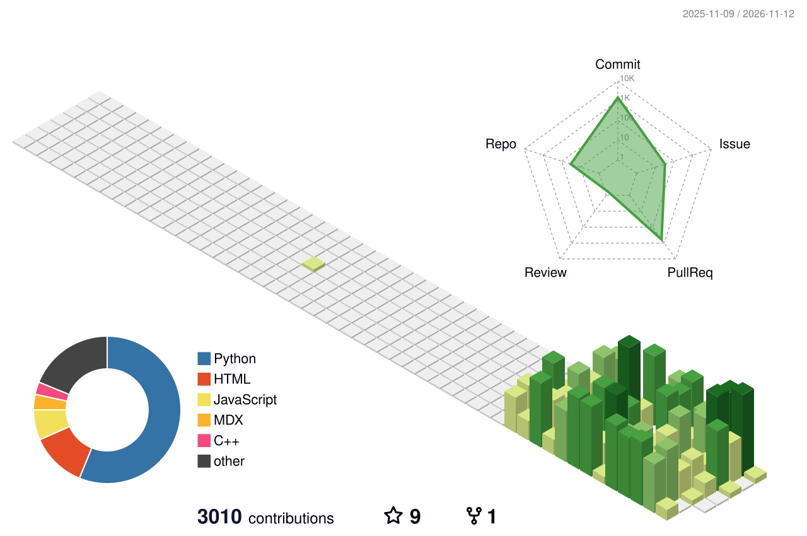
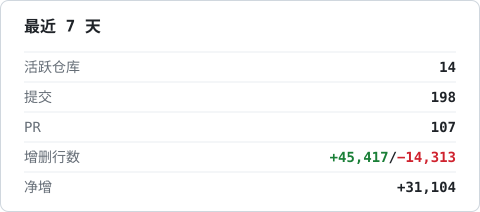

# 你好，我是温硕勋 👋

[English](https://github.com/Waldo0926/Waldo0926/blob/main/README.md) · **中文**

  

  
  
   
  

在Monash University Malaysia读计算机科学（算法与软件方向）。平时做学生工具、后端、安全项目，也折腾Linux服务器。其他仓库还有算法、数据、网络和早期课程实验。

开发过程、遇到的问题和解决办法写在[我的博客](https://blog.secureview.tech)；想把公开项目一次看完，可以去[项目归档](https://blog.secureview.tech/zh/projects/)。

### 项目方向总览

  

📫 **联系方式**

  
  
  
  
  
   
  
  

<strong>📱 扫码联系</strong>

 

  

---

## 精选项目

  
  
    
  
  
    
  
  

想看详细功能、截图、安装和测试，直接打开对应的项目仓库：

- **[Monash Hub](https://monashhub.secureview.tech)** — 课程、学位规划、WAM/GPA和带出处的官方资料（[代码](https://github.com/Waldo0926/monash-hub)）
- **[SecureView](https://github.com/Waldo0926/SecureView)** — 我们四人毕业设计的加密文件分享平台（[网站](https://secureview.tech)）
- **[Monash Study Kit](https://github.com/Waldo0926/monash-study-kit)** — 在AI里查自己的Moodle和Ed；可选邮箱和考勤，执行写操作前会要求确认（[指南](https://docs.secureview.tech/zh-cn/study-kit/)）
- **[Edge Fleet Ops Automation](https://github.com/Waldo0926/edge-fleet-ops-automation)** — 从早期Linux节点管理工具整理的脱敏版本
- **[签到助手](https://github.com/Waldo0926/monash-attendance-reminder)** — 查签到码，学生自行确认提交
- **[马莫百科问答机器人](https://github.com/Waldo0926/mumguide-wechat-bot)** — 在微信上回答学生问题并附来源

**[读博客](https://blog.secureview.tech/zh/)** · **[看全部项目](https://blog.secureview.tech/zh/projects/)** · **[学生工具指南](https://docs.secureview.tech/zh-cn/)** · **[网站运行状态](https://waldo0926.github.io/uptime/)**

## 更多项目

<strong>另外 22 个课程衍生与独立项目（按方向分组）</strong>

 

#### 学生工具、库与网页应用

| 项目 | 做的是什么 |
| --- | --- |
| [ed-web](https://github.com/Waldo0926/ed-web) | 隐私优先的纯前端 Ed Discussion 工具，用于抓取、整理、搜索和总结课程论坛。 |
| [monash-abroad-tracker-demo](https://github.com/Waldo0926/monash-abroad-tracker-demo) | 交换项目追踪器的公开演示版，用虚构数据（[在线演示](https://waldo0926.github.io/monash-abroad-tracker-demo/)）。私有正式系统自 2026 年 8 月起每天抓取约 164 个项目并遵守 `robots.txt`，支持字段级变化检测、与冻结的上一轮对比和人工核对的 QS 排名。 |
| [quotegate](https://github.com/Waldo0926/quotegate) | 发布在 PyPI 上的小型 Python 库，没有任何依赖：大模型只能用资料里的原句回答，每句发出前由程序逐字核对。从微信问答机器人里拆出来的。 |
| [monash-tools-docs](https://github.com/Waldo0926/monash-tools-docs) | 这些学生工具的中英文使用指南网站（[docs.secureview.tech](https://docs.secureview.tech)），用 Astro Starlight 搭建，同时提供 Study Kit 一键安装脚本，每天自动打包签到助手的安装包。 |

#### 软件系统、网络与基础设施

| 项目 | 做的是什么 |
| --- | --- |
| [enterprise-network-security-architecture](https://github.com/Waldo0926/enterprise-network-security-architecture) | 虚构企业的网络安全设计，写成 architecture-as-code，由 CI 里的校验器自动检查。 |
| [streamswitch](https://github.com/Waldo0926/streamswitch) | 基于 RxJS 的响应式数据包路由小游戏，使用不可变状态、确定性模拟与可测试事件流实现。 |
| [homelab-network-automation](https://github.com/Waldo0926/homelab-network-automation) | 基于爱快路由器 API 的家庭实验室网络自动化重构：受控连接清理、WAN/PPPoE/LAN 监控与状态化告警/恢复追踪。 |
| [wifi-site-survey-analysis](https://github.com/Waldo0926/wifi-site-survey-analysis) | 隐私安全的 Wi-Fi 现场勘测分析：RSSI、信道使用、物理 AP 去重漫游分析与可复现 Python 可视化。 |
| [bike-share-visualizer-cpp](https://github.com/Waldo0926/bike-share-visualizer-cpp) | 将 2021 年课程设计中基于 MFC 的共享单车站点可视化程序，重构为带真实数据测试与跨平台 CI 的现代 C++17 实现。 |

#### 算法、数据结构与底层编程

| 项目 | 做的是什么 |
| --- | --- |
| [advanced-string-algorithms](https://github.com/Waldo0926/advanced-string-algorithms) | 纯 Python 高级字符串算法：Ukkonen 后缀树、BWT 近似匹配、Z 算法精确匹配、Rabin-Karp 滚动哈希与 Miller-Rabin 素性测试，附 pytest 测试。 |
| [classical-algorithms-cpp](https://github.com/Waldo0926/classical-algorithms-cpp) | C++ 经典算法：动态规划、回溯、分支限界、分治与遗传算法。 |
| [data-structures-labs-cpp](https://github.com/Waldo0926/data-structures-labs-cpp) | 基于早期 C 风格数据结构课程实验重构的现代 C++17 实现，涵盖栈、队列、树、哈夫曼编码、图与排序。 |
| [bst-record-management-cpp](https://github.com/Waldo0926/bst-record-management-cpp) | 由早期数据结构课程设计重构的现代 C++17 二叉搜索树信息管理系统。 |
| [n-queens-algorithm-visualizer](https://github.com/Waldo0926/n-queens-algorithm-visualizer) | N 皇后算法可视化：回溯、状态空间剪枝与爬山算法对比。 |
| [MARIE-Bitmap-Text-Renderer](https://github.com/Waldo0926/MARIE-Bitmap-Text-Renderer) | MARIE 汇编位图渲染器：间接寻址、指针运算、4×8 字体、内存映射显示与 Python 参考模型。 |

#### 数据、机器学习与分析

| 项目 | 做的是什么 |
| --- | --- |
| [tensorflow-cnn-image-classification](https://github.com/Waldo0926/tensorflow-cnn-image-classification) | 基于 TensorFlow/Keras 的 CIFAR-10 与 MNIST CNN 可复现实验、自动评估与模型结构对比。 |
| [student-performance-ml-pipeline](https://github.com/Waldo0926/student-performance-ml-pipeline) | 基于 scikit-learn 的学生成绩分类：避免数据泄漏，涵盖 SVM、随机森林、超参数调优与类别不平衡评估。 |
| [pattern-recognition-from-scratch](https://github.com/Waldo0926/pattern-recognition-from-scratch) | 使用 NumPy 从零实现经典模式识别算法：朴素贝叶斯、感知机、Fisher LDA、K-Means、FCM 与 HMM。 |
| [million-row-tweet-analysis-bash-r](https://github.com/Waldo0926/million-row-tweet-analysis-bash-r) | 使用 Unix/Bash 流式管道、CSV 安全 Python 解析与 R 聚合/可视化分析 147 万条推文。 |

#### 数据库、机器人与信号处理

| 项目 | 做的是什么 |
| --- | --- |
| [database-systems-sql-labs](https://github.com/Waldo0926/database-systems-sql-labs) | 数据库系统课程实验与 T-SQL 实践，涵盖查询、关系设计、视图、索引、触发器与存储过程。 |
| [digital-signal-processing-matlab](https://github.com/Waldo0926/digital-signal-processing-matlab) | MATLAB 数字信号处理实验：FFT、采样、窗函数、FIR/IIR 滤波与生命体征分析。 |
| [puma560-robot-trajectory-planning](https://github.com/Waldo0926/puma560-robot-trajectory-planning) | 基于 MATLAB 的 PUMA 560 机器人运动学、欧拉角变换与笛卡尔轨迹规划仿真。 |

## 技术方向

`Python` · `TypeScript` · `C++` · `MCP` · `FastAPI` · `aiohttp` · `Vue` · `Nuxt` · `PostgreSQL` · `MySQL` · `SQLite` · `pytest` · `Playwright` · `Docker` · `Linux` · `Nginx` · `RxJS` · `网络安全` · `基础设施自动化` · `GitHub Actions`

## GitHub 活动

<picture>
  <source media="(prefers-color-scheme: dark)" srcset="./profile-3d-contrib/profile-night-green.svg" />
  
</picture>

由 GitHub Actions 每天用 <a href="https://github.com/yoshi389111/github-profile-3d-contrib">github-profile-3d-contrib</a> 自动生成。

<!-- RECENT_ACTIVITY:START -->
### 最近动态

<picture>
  <source media="(prefers-color-scheme: dark)" srcset="./assets/activity/activity-zh-dark.svg" />
  
</picture>

- **[waldo0926.github.io](https://github.com/Waldo0926/waldo0926.github.io)** 54 次提交 · 7 个 PR
- **[monash-hub](https://github.com/Waldo0926/monash-hub)** · 给 Monash 学生用的课程、学位和官方政策检索网站，已上线。 16 次提交 · 18 个 PR
- **[monash-study-kit](https://github.com/Waldo0926/monash-study-kit)** · 把 Moodle 和 Ed 接到 Claude 的本地 MCP 服务和命令行工具。 14 次提交 · 18 个 PR
- **[monash-tools-docs](https://github.com/Waldo0926/monash-tools-docs)** 8 次提交 · 8 个 PR
- **[Monash Exchange Tracker (private)](https://github.com/Waldo0926/monash-abroad-tracker-demo)** · 交换项目追踪的正式版，公开的 demo 用的是模拟数据。 3 次提交 · 3 个 PR
- **[mumguide-wechat-bot](https://github.com/Waldo0926/mumguide-wechat-bot)** · 学生公众号的中文问答机器人，不接大模型。 1 次提交 · 1 个 PR
- 另外 4 个私有仓库

统计各仓库默认分支上的提交和我开的 PR，包括私有仓库。由 GitHub Actions 每天更新，上次更新 2026-11-07。
<!-- RECENT_ACTIVITY:END -->

## 作品集说明

有几个仓库是在重做我本科早期的课程项目。遇到这种情况，我会把项目的历史记录保留清楚，把原本的课程作业和后来的重构、测试、文档、工程改进部分区分开。

另外有一些仓库是从真实私有环境中脱敏重构出来的公开展示版本；会保留工程思路，但不会公开凭据、私有拓扑、运营标识或生产环境细节。

**[查看全部仓库 →](https://github.com/Waldo0926?tab=repositories)**
