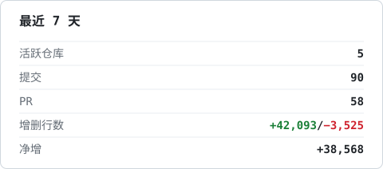

# 你好，我是温硕勋 👋

[English](https://github.com/Waldo0926/Waldo0926/blob/main/README.md) · **中文**

  

  
  
   
  
  

Monash University 计算机科学专业学生（算法与软件方向），主要做 **AI 应用和 Python 后端**：让 Claude 用上真实学生数据的 MCP 工具，用 FastAPI 和 aiohttp 写的 API 服务，以及配套的测试和部署。平时也做全栈产品和基础设施自动化，喜欢把应用算法落地成能用的软件。

目前在**马来西亚 / 中国**，正在找 **AI 应用开发和后端实习**。马来西亚 **2026 年 10 月 26 日**起可到岗，中国 **2026 年 11 月 9 日**起可到岗，都可以做到 **2027 年 2 月**。

### 项目方向总览

  

📫 **联系方式**

  
  
  
   
  
  

<strong>📱 扫码联系</strong>

 

  

---

## 精选项目

  
  
    
  
  
    
  
  

| 项目 | 在线体验 | 说明 |
| :---: | :---: | --- |
| **Monash Hub** | [monashhub.secureview.tech](https://monashhub.secureview.tech) | 一个人开发并已上线：课程、学位与官方政策检索（PostgreSQL 全文 + 模糊搜索）、带先修校验的课程规划、WAM/GPA 工具、学生社区，界面支持中、英、日、韩四种语言。 |
| **SecureView** | [secureview.tech](https://secureview.tech) | 四人毕业设计（FYP）：浏览器端六种 AEAD 加密、密钥包裹共享、完整性验证与哈希链审计。团队合并的 203 个 PR 中有 182 个由我提交，涵盖安全代理、完整性巡检、CI 与发布闸门、22,264 次操作的容量测试、篡改测试，以及受保护的自动部署。源码、测试和文档已放进仓库，仅供查看。 |
| **Monash Study Kit** | [最新版本](https://github.com/Waldo0926/monash-study-kit/releases/latest) | 本地优先的 MCP 服务（27 个工具）+ CLI，穿过 Okta/MFA 把 Moodle 和 Ed 接入 Claude：截止日期、公告、成绩，以及课件、课程笔记网页和录播字幕的全文搜索。设计上全部只读，已收录于 Glama。 |
| **Edge Fleet Ops Automation** | 仅代码 | 从真实 Linux 边缘节点集群运维脚本整理出的脱敏重构，涵盖节点发现、健康巡检、Docker 检查和状态化告警。 |
| **MUMGuide WeChat Bot** | 微信公众号“马莫百科” | 马莫百科公众号的中文问答机器人，全程不调用大模型。依次从站长教过的问答、Monash Hub API 和公众号文章里找答案，每条回答都附出处链接。后端用 aiohttp，部署在 Nginx 后面，数据存 SQLite，能在微信被动回复 5 秒、2048 字节的限制内答完。答不上的问题转给站长，站长回复后自动记住。用 pytest 和假 Hub 做离线测试。 |
| **Monash Exchange Tracker（演示版）** | [在线演示](https://waldo0926.github.io/monash-abroad-tracker-demo/) | 私有正式系统自 2026 年 8 月起每天抓取约 164 个项目并遵守 `robots.txt`，支持字段级变化检测、与冻结的上一轮对比、人工核对的 QS 排名和受访问控制的查看页面。公开演示使用虚构数据。 |

## 更多项目

<strong>另外 20 个课程衍生与独立项目（按方向分组）</strong>

 

#### 学生工具与网页应用

| 项目 | 做的是什么 |
| --- | --- |
| [ed-web](https://github.com/Waldo0926/ed-web) | 隐私优先的纯前端 Ed Discussion 工具，用于抓取、整理、搜索和总结课程论坛。 |
| [monash-attendance-reminder](https://github.com/Waldo0926/monash-attendance-reminder) | 可配置的 Monash 签到助手：自动发现近期课程，从 Gmail、Moodle 与 Ed（含本地 OCR）查找签到码、发送提醒，并仅在本人确认后提交。 |

#### 软件系统、网络与基础设施

| 项目 | 做的是什么 |
| --- | --- |
| [enterprise-network-security-architecture](https://github.com/Waldo0926/enterprise-network-security-architecture) | 虚构企业的网络安全设计，写成 architecture-as-code，由 CI 里的校验器自动检查。 |
| [streamswitch](https://github.com/Waldo0926/streamswitch) | 基于 RxJS 的响应式数据包路由小游戏，使用不可变状态、确定性模拟与可测试事件流实现。 |
| [homelab-network-automation](https://github.com/Waldo0926/homelab-network-automation) | 基于爱快路由器 API 的家庭实验室网络自动化重构：受控连接清理、WAN/PPPoE/LAN 监控与状态化告警/恢复追踪。 |
| [wifi-site-survey-analysis](https://github.com/Waldo0926/wifi-site-survey-analysis) | 隐私安全的 Wi-Fi 现场勘测分析：RSSI、信道使用、物理 AP 去重漫游分析与可复现 Python 可视化。 |
| [bike-share-visualizer-cpp](https://github.com/Waldo0926/bike-share-visualizer-cpp) | 将 2021 年课程设计中基于 MFC 的共享单车站点可视化程序，重构为带真实数据测试与跨平台 CI 的现代 C++17 实现。 |

#### 算法、数据结构与底层编程

| 项目 | 做的是什么 |
| --- | --- |
| [advanced-string-algorithms](https://github.com/Waldo0926/advanced-string-algorithms) | 纯 Python 高级字符串算法：Ukkonen 后缀树、BWT 近似匹配、Z 算法精确匹配、Rabin-Karp 滚动哈希与 Miller-Rabin 素性测试，附 pytest 测试。 |
| [classical-algorithms-cpp](https://github.com/Waldo0926/classical-algorithms-cpp) | C++ 经典算法：动态规划、回溯、分支限界、分治与遗传算法。 |
| [data-structures-labs-cpp](https://github.com/Waldo0926/data-structures-labs-cpp) | 基于早期 C 风格数据结构课程实验重构的现代 C++17 实现，涵盖栈、队列、树、哈夫曼编码、图与排序。 |
| [bst-record-management-cpp](https://github.com/Waldo0926/bst-record-management-cpp) | 由早期数据结构课程设计重构的现代 C++17 二叉搜索树信息管理系统。 |
| [n-queens-algorithm-visualizer](https://github.com/Waldo0926/n-queens-algorithm-visualizer) | N 皇后算法可视化：回溯、状态空间剪枝与爬山算法对比。 |
| [MARIE-Bitmap-Text-Renderer](https://github.com/Waldo0926/MARIE-Bitmap-Text-Renderer) | MARIE 汇编位图渲染器：间接寻址、指针运算、4×8 字体、内存映射显示与 Python 参考模型。 |

#### 数据、机器学习与分析

| 项目 | 做的是什么 |
| --- | --- |
| [tensorflow-cnn-image-classification](https://github.com/Waldo0926/tensorflow-cnn-image-classification) | 基于 TensorFlow/Keras 的 CIFAR-10 与 MNIST CNN 可复现实验、自动评估与模型结构对比。 |
| [student-performance-ml-pipeline](https://github.com/Waldo0926/student-performance-ml-pipeline) | 基于 scikit-learn 的学生成绩分类：避免数据泄漏，涵盖 SVM、随机森林、超参数调优与类别不平衡评估。 |
| [pattern-recognition-from-scratch](https://github.com/Waldo0926/pattern-recognition-from-scratch) | 使用 NumPy 从零实现经典模式识别算法：朴素贝叶斯、感知机、Fisher LDA、K-Means、FCM 与 HMM。 |
| [million-row-tweet-analysis-bash-r](https://github.com/Waldo0926/million-row-tweet-analysis-bash-r) | 使用 Unix/Bash 流式管道、CSV 安全 Python 解析与 R 聚合/可视化分析 147 万条推文。 |

#### 数据库、机器人与信号处理

| 项目 | 做的是什么 |
| --- | --- |
| [database-systems-sql-labs](https://github.com/Waldo0926/database-systems-sql-labs) | 数据库系统课程实验与 T-SQL 实践，涵盖查询、关系设计、视图、索引、触发器与存储过程。 |
| [digital-signal-processing-matlab](https://github.com/Waldo0926/digital-signal-processing-matlab) | MATLAB 数字信号处理实验：FFT、采样、窗函数、FIR/IIR 滤波与生命体征分析。 |
| [puma560-robot-trajectory-planning](https://github.com/Waldo0926/puma560-robot-trajectory-planning) | 基于 MATLAB 的 PUMA 560 机器人运动学、欧拉角变换与笛卡尔轨迹规划仿真。 |

## 技术方向

`Python` · `TypeScript` · `C++` · `MCP` · `FastAPI` · `aiohttp` · `Vue` · `Nuxt` · `PostgreSQL` · `MySQL` · `SQLite` · `pytest` · `Playwright` · `Docker` · `Linux` · `Nginx` · `RxJS` · `网络安全` · `基础设施自动化` · `GitHub Actions`

## GitHub 活动

<picture>
  <source media="(prefers-color-scheme: dark)" srcset="./profile-3d-contrib/profile-night-green.svg" />
  
</picture>

由 GitHub Actions 每天用 <a href="https://github.com/yoshi389111/github-profile-3d-contrib">github-profile-3d-contrib</a> 自动生成。

<!-- RECENT_ACTIVITY:START -->
### 最近动态

<picture>
  <source media="(prefers-color-scheme: dark)" srcset="./assets/activity/activity-zh-dark.svg" />
  
</picture>

- **[monash-hub](https://github.com/Waldo0926/monash-hub)** · 给 Monash 学生用的课程、学位和官方政策检索网站，已上线。 33 次提交 · 33 个 PR
- **[SecureView](https://github.com/Waldo0926/SecureView)** · 四人毕业设计，浏览器端加密的文件共享平台。私有团队仓库的提交也算在这里。 28 次提交 · 20 个 PR
- **[monash-attendance-reminder](https://github.com/Waldo0926/monash-attendance-reminder)** · 从邮件、Moodle 和 Ed 找签到码并提醒签到的 Chrome 扩展，确认后才提交。 2 次提交 · 2 个 PR
- 另外 2 个私有仓库

统计各仓库默认分支上的提交和我开的 PR，包括私有仓库。由 GitHub Actions 每天更新，上次更新 2026-10-18。
<!-- RECENT_ACTIVITY:END -->

## 作品集说明

有几个仓库是在重做我本科早期的课程项目。遇到这种情况，我会把项目的历史记录保留清楚，把原本的课程作业和后来的重构、测试、文档、工程改进部分区分开。

另外有一些仓库是从真实私有环境中脱敏重构出来的公开展示版本；会保留工程思路，但不会公开凭据、私有拓扑、运营标识或生产环境细节。

**[查看全部仓库 →](https://github.com/Waldo0926?tab=repositories)**
